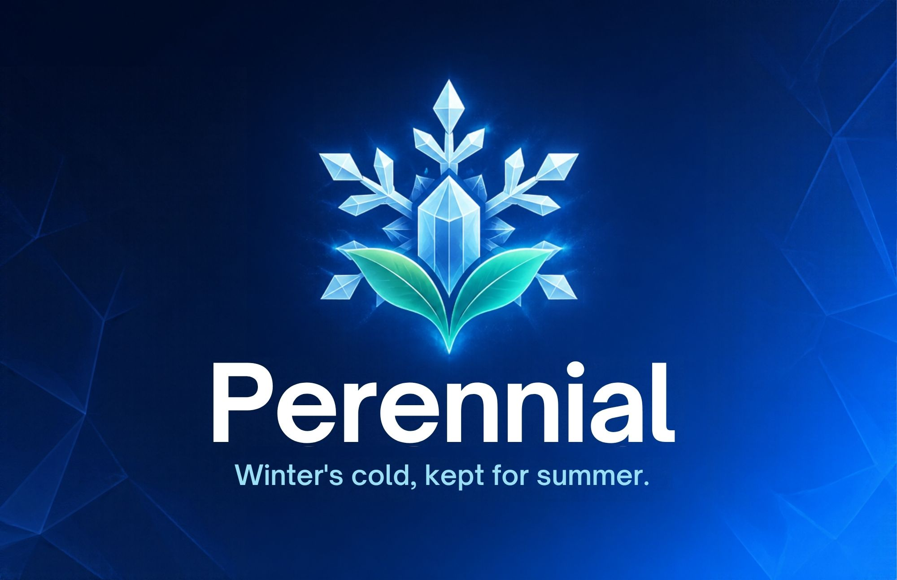

<div align="center">



# Perennial

### Turning a city's wasted snow into clean cooling for data centers.

**Hackachusetts 2026 · Energy & Climate Tech**

🌐 **Live demo: [perennial-murex.vercel.app](https://perennial-murex.vercel.app)**

</div>

---

## The problem

AI data centers drank roughly **17 billion gallons of fresh water in 2023** just to stay cool, a
figure projected to multiply by 2030 (Lawrence Berkeley National Lab / DOE). A single large
facility can consume as much water as a town of 50,000 people (Brookings).

Meanwhile, snowy cities treat snow as garbage. Boston spends about **$47 million a year** plowing,
hauling, and dumping it, and in 2015 the city's Seaport "snow farm" piled snow **75 feet high**
that did not fully melt until **mid-July**.

## The idea

That snow pile is a free, seasonal cold battery. Perennial harvests it.

Instead of evaporating fresh water in cooling towers (an **open loop** that consumes water),
a data center dumps its heat into melting snow through a sealed **shell-and-tube heat exchanger**
(a **closed loop** that borrows winter's cold). The dirty meltwater and the ultrapure coolant
never mix, only heat crosses the tube wall. Snow cooling is seasonal, so it **shaves the summer
peak**, the hottest weeks when cooling towers drink the most and the grid is most stressed.

The approach is proven: a hospital in Sundsvall, Sweden has cooled itself with stored winter snow
since 2000. Perennial is the software layer to plan it, quantify it, and scale it.

## What Perennial does

Perennial connects the people who **have snow** (cities) with the people who **need cold**
(GPU data centers), and does the math for both.

| View | For | What it answers |
|------|-----|-----------------|
| **City** | Public Works | Where is my snow? Live NWS forecast, pick any date for real NOAA snowfall, snow-farm map, AI season prediction. |
| **Calculator** | GPU data centers | How much can I save? Water, energy, CO₂, and % of summer peak covered, with every assumption editable and a step-by-step "show the math". |
| **Dashboard** | Customers | A sustainability snapshot: KPIs, carbon-credit value, growth outlook, downloadable PDF report. |
| **Logic** | Skeptics / judges | The engineering: an AutoCAD-style cooler schematic and every formula + data source. |

Plus an **AI assistant** (Claude) that reads your live scenario and changes inputs for you
("use the 2015 blizzard", "double collection efficiency", "try the Lowell site").

## Real data, honest numbers

Every figure traces to a public source, no black boxes:

- **Snowfall (history):** NOAA GHCN-Daily via the ACIS API (Boston Logan station).
- **Forecast:** US National Weather Service (api.weather.gov).
- **Terrain:** USGS 3DEP elevation/slope/aspect.
- **Buildings / grid / equity:** Boston BERDO, MassGIS utility + landfill + EJ layers.
- **Physics:** latent heat of fusion of ice = 334 kJ/kg (NIST); WUE / PUE (The Green Grid).

Honesty guardrails baked into the product: SI units internally, two independent estimates of
collected snow that are cross-checked, and results reported as a **fraction of demand / peak
offset**, never a magic "100%".

## How the numbers connect

```
NOAA snowfall ─┐
NWS forecast ──┤→ collected snow (2 methods, cross-checked) → surviving ice (melt loss)
USGS terrain ──┘                                                        │
                                                                        ▼
                             shell-and-tube heat exchanger (effectiveness × fouling)
                                                                        │
                                                                        ▼
            cooling delivered ──┬── fresh water NOT evaporated (× WUE)
                                └── chiller electricity avoided (÷ COP) → CO₂ avoided (× grid intensity)
                                                                        │
                                                                        ▼
                                                     carbon credits (1 credit = 1 t CO₂)
```

## Architecture

```
web/      React + TypeScript + Vite frontend (map: MapLibre, PDF: jsPDF)
api/      FastAPI serverless API (Vercel Python function)
engine/   Pure-Python calculation core (physics, snow, piles, offset, carbon, predictor)
mcp_server/  Model Context Protocol server exposing NOAA / NWS / USGS as agent tools
tests/    Property-based tests (Hypothesis)
.kiro/    Specs, steering docs, and agent hooks
```

The engine is pure functions with SI units, which makes it fast, testable, and provable with
property-based tests. The frontend shares one **scenario** context so every view moves together.

## Run it locally

**Backend (Python 3.12+):**
```bash
python -m venv .venv
.venv\Scripts\activate            # Windows   (source .venv/bin/activate on macOS/Linux)
pip install -r requirements-dev.txt
uvicorn api.main:app --reload --port 8000
```

**Frontend (Node 20+):**
```bash
cd web
npm install
npm run dev            # http://localhost:5173 (proxies /api to :8000)
```

**Tests:**
```bash
pytest -q              # property-based + unit tests
```

**AI assistant (optional):** set `ANTHROPIC_API_KEY` in the backend's environment to enable the
Claude assistant; without it, the assistant uses a built-in scripted guide so nothing breaks.

## How Kiro built this

See **[KIRO_WRITEUP.md](KIRO_WRITEUP.md)** for the full story. In short: Perennial was built
spec-first in Kiro, with steering docs enforcing honesty and SI units, agent hooks running the
test suite and guarding `.kiro/` on every save, a custom MCP server letting Kiro pull live
NOAA/NWS/USGS data, and property-based tests that caught a 24× estimation error our eyes missed.

## License / data use

Original work for Hackachusetts 2026. All datasets are public; each is cited to its agency.
Official pages are linked, not rehosted.
